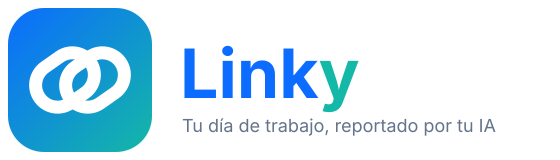
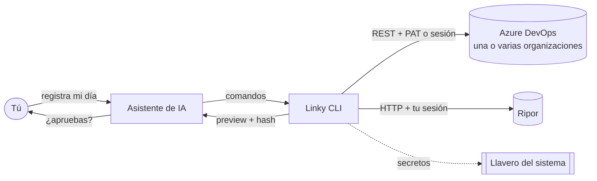

<p align="center">
  
</p>

<p align="center">
  
  
  
  
  
</p>

<p align="center"><b>Tu trabajo en Azure DevOps y tu reporte diario en Ripor, hechos por tu asistente de IA.</b><br>
Sin abrir el navegador cada día. Sin inventar horas. Con tu aprobación en cada cambio.</p>

---

## ¿Qué es Linky?

Trabajas en **Azure DevOps**, a veces en varias organizaciones a la vez (la de tu empresa y la de un cliente o consorcio). Al final del día tienes que reportar tu jornada en **Ripor**: proyecto de área, horas exactas, una descripción breve, evidencia y medio de transporte.

Linky es un **CLI con skills** que cualquier asistente de IA con acceso a terminal puede usar para hacer ese trabajo por ti:

- **Lee lo que hiciste** en Azure DevOps (tareas creadas, estados, horas completadas, comentarios) en todas tus organizaciones.
- **Crea y actualiza tus Tasks** con descripción corta y evidencias, respetando quién puede crear o cerrar qué.
- **Llena tu reporte de Ripor** con un resumen breve de ese trabajo, la evidencia correcta y las horas de tu jornada; y si algo salió mal, lo **edita, borra o recrea**.

No es una app ni una página web: son comandos locales. Funciona igual en **Windows, macOS y Linux**, y no depende de ningún proveedor de IA.

## Cómo funciona



1. **Conectas tus cuentas una sola vez.** Azure con PAT (recomendado) o iniciando sesión en el navegador; Ripor iniciando sesión con tu cuenta de Google. El navegador se abre solo para eso y se cierra solo.
2. **Desde ahí todo va por petición directa**, sin navegador: rápido y sin depender de la interfaz.
3. **Cada cambio pasa por un preview** con lo que se enviará (antes/después) y un hash. Nada se escribe sin tu aprobación sobre ese preview exacto.
4. **Linky verifica después de escribir.** Si algo no cuadra, se detiene y te pide reconciliar en lugar de repetir a ciegas.

## Reglas que respeta

| Ripor | |
|---|---|
| Jornada | **8,5 h** de lunes a jueves, **8 h** los viernes, sumando todos los reportes del día. Nunca más. |
| Menos horas | Solo si tú lo pides explícitamente para esa fecha. |
| Fechas | La de hoy en tu equipo. Sin fechas futuras ni fines de semana. |
| Proyecto | El **proyecto de tu área** en Ripor, que no es lo mismo que tus proyectos de Azure. |
| Tarea | "Tarea Personalizada" por defecto. |
| Descripción | Breve: resumen en pasado de tu trabajo real; 50 a 500 caracteres. |
| Evidencia | Un enlace real que abra (tu HU o Task de Azure, un PR, un documento). |
| Transporte | El tuyo por defecto (trabajo remoto, moto, transporte público…), con cambio puntual por día. |

| Azure DevOps | |
|---|---|
| Organizaciones | Una **principal** (default) y las secundarias que quieras, cada una con su credencial. |
| Estados | Planeación → en curso → entregado. **Cerrar** solo con tu intención explícita y una aprobación aparte. |
| Horas | Reales; la estimación se separa de lo trabajado. Nada inventado. |

## Empezar

Requisitos: **Node.js 24** y Google Chrome o Microsoft Edge (solo para iniciar sesión).

```bash
git clone https://github.com/ldikay99/linky.git
cd linky
npm install
```

**1. Conecta Azure DevOps** (tu organización principal primero):

```bash
npm run linky -- azure connect --org https://dev.azure.com/<tu-org> --primary   # pide el PAT oculto
npm run linky -- azure connect --org https://dev.azure.com/<otra-org>           # opcional: más organizaciones
npm run linky -- azure login --org https://dev.azure.com/<tu-org>               # alternativa sin PAT
npm run linky -- azure orgs                                                     # ver cuáles quedaron
```

**2. Conecta Ripor:**

```bash
npm run linky -- ripor login                                  # abre el navegador; inicias sesión; se cierra solo
npm run linky -- ripor catalog --from-date <un día que ya reportaste>
npm run linky -- ripor setup --answers ~/.linky/ripor-setup-answers.json --transporte "🏠 Trabajo Remoto"
```

**3. Dile a tu asistente:** *"registra mi día en Ripor con lo que hice ayer en Azure"*. Por debajo hará algo así:

```bash
npm run linky -- azure activity --date 2026-11-04          # qué hiciste (usa --all para todas tus organizaciones)
npm run linky -- ripor list                                # qué hay reportado hoy
npm run linky -- ripor preview --notes "<resumen breve>" --evidence <enlace HU> --sustained 8.5
npm run linky -- ripor apply --preview <archivo> --approve --by <tú> --snapshot <hash>
```

Para corregir: `ripor preview --update <id>` (muestra antes/después). Para borrar: `ripor delete-preview` más una confirmación aparte.

## Para asistentes de IA

Carga las skills; contienen el flujo completo, las reglas y qué preguntar:

- [`skills/linky-azure-boards/SKILL.md`](skills/linky-azure-boards/SKILL.md): Azure DevOps.
- [`skills/linky-ripor/SKILL.md`](skills/linky-ripor/SKILL.md): Ripor.
- [`AGENTS.md`](AGENTS.md): reglas comunes.

## Seguridad

- **Tus credenciales nunca salen de tu equipo.** PATs y sesiones viven en el llavero del sistema (Windows Credential Manager, macOS Keychain, Secret Service en Linux). Nada en el repo, en archivos de texto ni en logs.
- Clonar este repo no da acceso a la cuenta de nadie: cada persona conecta las suyas.
- `npm install` activa un **pre-commit** que bloquea commits con PATs, cookies de sesión o tokens (`npm run scan`).
- Si alguna vez pegas un token en un chat, revócalo y crea otro.

## Documentación

[Referencia Ripor](docs/REFERENCIA-RIPOR.md) · [Referencia Azure](docs/REFERENCIA-AZURE.md) · [Permisos del PAT](docs/PERMISOS-PAT.md) · [Recordatorio de vencimiento](docs/RECORDATORIO-PAT.md) · [Modo navegador guiado](docs/BROWSER-MCP.md)

## Desarrollo

```bash
npm test           # suite con servicios simulados (sin cuentas reales)
npm run typecheck
npm run scan       # busca secretos en el árbol
npm run demo:mock  # flujo Azure offline
npm run demo:ripor # flujo Ripor offline
```

El CI corre en Windows, macOS y Linux.

---

<p align="center">Creado por <b>Jonathan Contreras</b></p>
