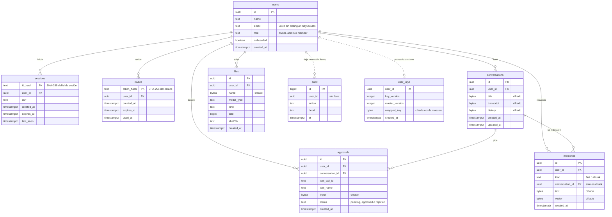

# Modelo de datos en PostgreSQL

Tablas de la web de Linky para el servidor del área: personas, sesiones, conversaciones, memoria, adjuntos,
aprobaciones y auditoría. Parte del esquema SQLite que la web usa hoy, de los roles de
[ROLES-Y-PERMISOS.md](ROLES-Y-PERMISOS.md) y de las reglas de [DATOS-SENSIBLES.md](DATOS-SENSIBLES.md).

Lo marcado **hoy** ya está en las migraciones (`web/server/store/migrations/postgres/`) y lo usa la web con
`DATABASE_URL`. Lo marcado **planeado** es una migración futura, atada a una brecha de `DATOS-SENSIBLES.md`.

## Principios

| Principio | Cómo se cumple |
|---|---|
| Todo es de una persona | Cada tabla con datos de alguien lleva `user_id uuid NOT NULL` con llave a `users` y `ON DELETE CASCADE`. Borrar la fila de la persona borra todo lo suyo en una operación. |
| Lo confidencial va cifrado por Linky | Columnas `bytea` con AES-256-GCM y la clave de la persona (ver [Cifrado](#cifrado)). La base nunca recibe la clave ni el texto: un volcado, un respaldo o un log de consultas no revelan contenido. |
| Aislamiento también en la base | Row Level Security en las tablas de contenido: cada transacción solo ve y escribe filas de la persona fijada (ver [Aislamiento por persona](#aislamiento-por-persona)). |
| Tiempos sin ambigüedad | `timestamptz` en todas las fechas (se guardan en UTC). La web trabaja en milisegundos y los convierte al leer y escribir. |
| Ids sin significado | `uuid` generados por la web (`randomUUID`). No revelan orden ni cantidad, y son el dato asociado del cifrado. |
| La base valida lo que puede | `CHECK` en roles, tipos, estados, formatos de hash y tamaños; llaves compuestas para que nada cuelgue de un registro de otra persona. |
| Cambios versionados | Migraciones numeradas `NNNN_nombre.sql`, aplicadas al arrancar, cada una en su transacción, con su huella en `schema_migrations`. Ver `web/README.md`. |

## Diagrama



`approvals` y `memories` llegan a `conversations` por la llave compuesta `(conversation_id, user_id)`: la base no deja
colgar una aprobación o un fragmento de la conversación de otra persona.

## Tablas

Columnas: **Cifrado** indica que el valor es `bytea` con AES-256-GCM; el resto queda en claro y no tiene contenido
de la persona (ids, fechas, tipos, estados) o es su identidad básica (nombre, correo, rol), como define
`DATOS-SENSIBLES.md`.

### users — personas

| Columna | Tipo | Nulo | Restricciones | Cifrado |
|---|---|---|---|---|
| `id` | `uuid` | no | PK | no |
| `name` | `text` | no | hasta 200 caracteres; vacío permitido (en contenedores el nombre llega al conectar Azure) | no |
| `email` | `text` | sí | hasta 320 caracteres, con `@`; único sin distinguir mayúsculas | no |
| `role` | `text` | no | `owner`, `admin` o `member` | no |
| `onboarded` | `boolean` | no | por defecto `false` | no |
| `created_at` | `timestamptz` | no | por defecto `now()` | no |

Índices: `users_email_unique` (único, `lower(email)` donde hay correo) y `users_single_owner` (único: una sola
`owner`).

Roles: `member` es el rol **user** de `ROLES-Y-PERMISOS.md` y `admin` es **admin**. `owner` es la persona dueña de la
instalación en su propio equipo (modo `single`); en el servidor del área (modo `multi`) no se usa. Se conservan los
valores del código para no migrar datos existentes.

Planeado: `disabled_at timestamptz` (desactivar la cuenta: no inicia sesión y se borran sus sesiones) y, según el
método de inicio de sesión que se elija para el modo `multi`, la tabla de credenciales (hash de contraseña resistente
a fuerza bruta, intentos fallidos, bloqueo temporal) o el id de la cuenta de Google Workspace.

### sessions — sesiones de la web

| Columna | Tipo | Nulo | Restricciones | Cifrado |
|---|---|---|---|---|
| `id_hash` | `text` | no | PK; SHA-256 en hexadecimal (64 caracteres) | hash |
| `user_id` | `uuid` | no | FK `users`, cascada | no |
| `csrf` | `text` | no | 16 a 128 caracteres | no (planeado: hash) |
| `created_at` | `timestamptz` | no | | no |
| `expires_at` | `timestamptz` | no | posterior a `created_at` | no |
| `last_seen` | `timestamptz` | no | | no |

Índices: `sessions_user` (cascada al borrar la persona) y `sessions_expires` (purga horaria). El id de la sesión solo
existe en la cookie del navegador; un volcado de la tabla no da acceso.

Planeado: `csrf` pasa a hash o se deriva del id de sesión (brecha "token CSRF en claro") y un índice por `last_seen`
para el cierre por inactividad.

### invites — invitaciones

| Columna | Tipo | Nulo | Restricciones | Cifrado |
|---|---|---|---|---|
| `token_hash` | `text` | no | PK; SHA-256 en hexadecimal | hash |
| `user_id` | `uuid` | no | FK `users`, cascada | no |
| `created_at` | `timestamptz` | no | | no |
| `expires_at` | `timestamptz` | no | posterior a `created_at` | no |
| `used_at` | `timestamptz` | sí | se marca con un solo `UPDATE` condicionado: un enlace no entra dos veces | no |

Índices: `invites_user`, `invites_expires`.

### conversations — conversaciones

| Columna | Tipo | Nulo | Restricciones | Cifrado |
|---|---|---|---|---|
| `id` | `uuid` | no | PK; `UNIQUE (id, user_id)` como destino de las llaves compuestas | no |
| `user_id` | `uuid` | no | FK `users`, cascada | no |
| `title` | `bytea` | no | 29 bytes o más | sí |
| `transcript` | `bytea` | no | lo que ve la persona (mensajes, tarjetas, herramientas) | sí |
| `history` | `bytea` | no | historial del modelo, resumen y previews | sí |
| `created_at` | `timestamptz` | no | | no |
| `updated_at` | `timestamptz` | no | orden de la lista y plazo de retención | no |

Índice: `conversations_user (user_id, updated_at DESC)` para la lista de la persona. `transcript` y `history` usan
`STORAGE EXTERNAL`: lo cifrado no se comprime, así la base no gasta tiempo intentándolo.

### files — adjuntos

El contenido de cada adjunto va cifrado en disco (`files/<persona>/<id>.bin`, clave `files` de la persona); la tabla
guarda los metadatos.

| Columna | Tipo | Nulo | Restricciones | Cifrado |
|---|---|---|---|---|
| `id` | `uuid` | no | PK; también es el dato asociado del archivo cifrado | no |
| `user_id` | `uuid` | no | FK `users`, cascada | no |
| `name` | `bytea` | no | nombre original | sí |
| `media_type` | `text` | no | tipo real verificado por contenido; hasta 255 | no |
| `kind` | `text` | no | `image`, `pdf`, `word`, `sheet`, `slides` o `text` | no |
| `size` | `bigint` | no | mayor que 0 | no |
| `sha256` | `text` | no | 64 caracteres hexadecimales | no (planeado: HMAC) |
| `created_at` | `timestamptz` | no | plazo de retención | no |

Índice: `files_user (user_id, created_at DESC)`.

Planeado: `sha256` pasa a HMAC con clave de la persona (brecha "huella en claro") y una relación adjunto-conversación
para borrar los adjuntos que solo usa una conversación al borrarla (brecha "borrar una conversación no borra sus
adjuntos").

### approvals — aprobaciones de escrituras

| Columna | Tipo | Nulo | Restricciones | Cifrado |
|---|---|---|---|---|
| `id` | `uuid` | no | PK | no |
| `user_id` | `uuid` | no | FK `users`, cascada | no |
| `conversation_id` | `uuid` | no | FK compuesta `(conversation_id, user_id)` a `conversations`, cascada | no |
| `tool_call_id` | `text` | no | 1 a 200 caracteres | no |
| `tool_name` | `text` | no | 1 a 100 caracteres | no |
| `input` | `bytea` | no | entrada de la herramienta que se aplicará | sí |
| `status` | `text` | no | `pending` (por defecto), `approved` o `rejected` | no |
| `created_at` | `timestamptz` | no | | no |

Índices: `approvals_conversation` (cascada) y `approvals_pending (user_id, conversation_id) WHERE status = 'pending'`.
Una aprobación pasa de `pending` a su estado final con un solo `UPDATE … WHERE status = 'pending'`: dos clics no
aplican dos veces.

### memories — memoria de la persona

| Columna | Tipo | Nulo | Restricciones | Cifrado |
|---|---|---|---|---|
| `id` | `uuid` | no | PK | no |
| `user_id` | `uuid` | no | FK `users`, cascada | no |
| `kind` | `text` | no | `fact` (recuerdo) o `chunk` (fragmento de conversación) | no |
| `conversation_id` | `uuid` | sí | FK compuesta a `conversations`, cascada; nula en `fact` y obligatoria en `chunk` | no |
| `text` | `bytea` | no | | sí |
| `vector` | `bytea` | sí | embedding; nulo si no hay proveedor de embeddings | sí |
| `created_at` | `timestamptz` | no | | no |

Índices: `memories_user (user_id, kind, created_at DESC)` y `memories_conversation` (cascada).

#### Vector: `bytea` cifrado, no pgvector

Se guarda cifrado en `bytea` y la similitud se calcula en la web después de descifrar. Razones:

1. **Un vector revela el contenido.** Con un embedding se puede reconstruir buena parte del texto que lo originó, así
   que es personal confidencial y va cifrado por persona como el texto. pgvector necesita el vector en claro dentro de
   la base para indexarlo y medir distancias: quedaría visible en volcados, respaldos y para quien administre la base.
2. **El volumen por persona es pequeño.** La búsqueda es siempre dentro de una persona y lee como máximo 5.000
   filas. Descifrar y comparar eso en Node toma milisegundos; un índice aproximado (HNSW o IVFFlat) no aporta a esa escala.
3. **La búsqueda es mixta.** Combina significado (70 %) y palabras exactas con BM25 (30 %), que también necesita el
   texto en claro: de todos modos ocurre en la web.
4. **Un solo modelo para los dos motores.** SQLite y PostgreSQL guardan lo mismo y con el mismo cifrado, sin
   depender de una extensión.

Cuándo revisarlo: si una persona supera unas 50.000 filas de memoria o la búsqueda pasa de 200 ms. La alternativa
entonces requiere una revisión de seguridad propia (por ejemplo, un almacén de vectores aparte con su propio control
de acceso). Mejora posible sin cambiar la decisión: guardar el vector como `Float32` binario antes de cifrarlo (hoy
es JSON; ocuparía cerca de la mitad). El byte de versión del cifrado permite cambiar el formato sin romper lo
guardado.

### audit — auditoría

| Columna | Tipo | Nulo | Restricciones | Cifrado |
|---|---|---|---|---|
| `id` | `bigint` | no | PK, `GENERATED ALWAYS AS IDENTITY` | no |
| `user_id` | `uuid` | sí | **sin** llave a `users`: sobrevive al borrado de la cuenta con un id que ya no se asocia a nadie | no |
| `action` | `text` | no | 1 a 100 caracteres (`approval.approved`, `connector.azure.connect`, …) | no |
| `detail` | `text` | sí | hasta 500 caracteres: resultado y conteos, nunca contenido ni secretos | no |
| `at` | `timestamptz` | no | | no |

Índices: `audit_at` (purga por plazo) y `audit_user (user_id, at DESC)` (consulta del admin). Un disparador impide
modificar filas: la auditoría solo crece y la purga por plazo borra, no corrige.

### user_keys — clave de cada persona (planeado)

Cierra las brechas "las claves por persona se derivan de la maestra" y "no hay rotación de la clave maestra".

| Columna | Tipo | Nulo | Restricciones |
|---|---|---|---|
| `user_id` | `uuid` | no | PK, FK `users`, cascada |
| `key_version` | `integer` | no | versión de la clave de la persona |
| `master_version` | `integer` | no | versión de la clave maestra que la envuelve |
| `wrapped_key` | `bytea` | no | clave aleatoria de 32 bytes cifrada con la maestra (AES-256-GCM, dato asociado: id y versiones) |
| `created_at` | `timestamptz` | no | |

- La web desenvuelve la clave al primer uso y de ella deriva los propósitos (`data`, `files`, `vault`) con HKDF, como
  hoy hace desde la maestra.
- Borrar la cuenta borra esta fila: lo que quede de esa persona en respaldos ya no se puede leer.
- Rotar la maestra es reenvolver estas filas (una por persona), no recifrar todo el contenido.
- Sin Row Level Security: la web la lee antes de fijar a la persona y su valor no sirve sin la maestra.

### schema_migrations — control de versiones

| Columna | Tipo | Restricciones |
|---|---|---|
| `version` | `integer` | PK |
| `name` | `text` | nombre del archivo sin número |
| `checksum` | `text` | SHA-256 del archivo (saltos de línea normalizados) |
| `applied_at` | `timestamptz` | por defecto `now()` |

La crea la web antes de migrar. Aplicar una migración y registrarla ocurre en la misma transacción.

## Cifrado

Todo valor cifrado tiene el formato `versión (1 byte) | IV (12) | etiqueta GCM (16) | contenido`, por eso las
columnas exigen 29 bytes o más. La clave es la de propósito `data` de la persona (HKDF-SHA256 de la maestra con el id
de la persona como sal; planeado: desde `user_keys`). El dato asociado (AAD) nombra la columna y el id de la fila:
un valor copiado a otra fila, columna o persona no se descifra.

| Tabla.columna | Dato asociado | Qué contiene |
|---|---|---|
| `conversations.title` | `conv-title:<id>` | Título |
| `conversations.transcript` | `conv-transcript:<id>` | JSON de los mensajes que ve la persona |
| `conversations.history` | `conv-history:<id>` | JSON del historial del modelo, resumen y previews |
| `files.name` | `file-name:<id>` | Nombre original del adjunto |
| `approvals.input` | `approval:<id>` | JSON de la entrada de la herramienta |
| `memories.text` | `mem:<id>` | Texto del recuerdo o fragmento |
| `memories.vector` | `mem-vec:<id>` | JSON del embedding |
| (disco) `files/<persona>/<id>.bin` | `file:<id>` | Contenido del adjunto (clave `files`) |

El cifrado ocurre en la web (`web/server/store/sealed.ts`), igual para SQLite y PostgreSQL. Por eso los datos se
pueden copiar de un motor al otro sin descifrarlos.

## Aislamiento por persona

Las tablas `conversations`, `files`, `approvals` y `memories` tienen Row Level Security con `FORCE` (aplica también al
dueño de las tablas) y la política `solo_la_persona`:

```sql
USING (user_id = linky_current_user()) WITH CHECK (user_id = linky_current_user())
```

`linky_current_user()` lee `linky.user_id` de la transacción. La web abre cada operación de una persona con
`BEGIN` y `set_config('linky.user_id', <id>, true)` (solo dura esa transacción, así un cliente del pool no hereda a
otra persona). Sin persona fijada no se ve ni se escribe ninguna fila.

Por qué vale la pena: CA-7 pide que cada persona solo vea lo suyo. La web ya filtra por `user_id` en cada consulta;
RLS es la segunda barrera para el día en que una consulta nueva olvide el filtro. El costo es una transacción corta
por operación.

Por qué no en las demás tablas: `users`, `sessions` e `invites` se consultan antes de saber quién es la persona (para
autenticarla) y no tienen contenido; `audit` la consulta el admin y no tiene contenido.

Condiciones para que sirva:

- La web se conecta con un rol sin superusuario ni `BYPASSRLS`; si no, lo avisa al arrancar. En Docker es el rol
  `linky`; `linky_admin` queda solo para mantenimiento.
- RLS protege de errores de la aplicación, no de quien controla el rol dueño (podría desactivarla). Planeado para
  el servidor del área: un rol dueño que solo migra y un rol de la aplicación con permisos de lectura y escritura,
  sin `ALTER`.

## Retención y borrado

El modelo ya tiene lo que necesitan las reglas de `DATOS-SENSIBLES.md`:

| Regla | Apoyo en el modelo |
|---|---|
| Sesión: 7 días y cierre tras 12 h sin uso | `sessions.expires_at` (índice) y `last_seen` |
| Invitación de 72 h y un solo uso | `invites.expires_at` (índice) y `used_at` |
| Conversación: 12 meses desde su última actualización | `conversations.updated_at` (índice con `user_id`); sus aprobaciones y fragmentos se van en cascada |
| Adjuntos: 12 meses desde la carga | `files.created_at` (índice con `user_id`) |
| Auditoría: 12 meses | `audit.at` (índice) |
| Borrado de cuenta completa | `DELETE FROM users` borra en cascada sesiones, invitaciones, conversaciones, adjuntos, aprobaciones y memoria; la auditoría queda con el id suelto; planeado: borra también su fila de `user_keys` |
| Verificación del borrado | Contar por `user_id` en cada tabla debe dar cero (hay una prueba automática que lo hace en PostgreSQL) |

## Diferencias con el esquema SQLite actual

Mismo modelo y mismo cifrado; cambian los tipos y lo que la base valida.

| Aspecto | SQLite (equipo de una persona) | PostgreSQL (servidor del área) |
|---|---|---|
| Ids | `TEXT` | `uuid` (la web devuelve "no existe" ante un id que no es UUID, sin consultar) |
| Tiempos | `INTEGER` en milisegundos | `timestamptz` |
| `users.onboarded` | `INTEGER` 0 o 1 | `boolean` |
| Contenido cifrado | `BLOB` | `bytea`, con longitud mínima y `STORAGE EXTERNAL` en lo grande |
| Auditoría | `INTEGER AUTOINCREMENT`, se puede modificar | `bigint` identity; un disparador impide modificarla |
| Validaciones | Solo `NOT NULL` y llaves | `CHECK` de rol, tipo, estado, formato de hashes, tamaños y regla recuerdo/fragmento; correo único; una sola dueña |
| Llaves de aprobaciones y fragmentos | A la conversación | Compuestas `(conversation_id, user_id)`: misma persona |
| Aislamiento | No aplica (una persona por archivo) | Row Level Security en las tablas de contenido |
| `invites.created_at` | No existe | Existe |
| Migración 0001 | `CREATE TABLE IF NOT EXISTS`: reconoce las bases creadas antes de las migraciones | `CREATE TABLE`: no hay bases anteriores |
| Migración 0002 | Agrega índices de cascada, aprobaciones pendientes y purga | Sin cambios (ya están en 0001); existe para que la versión signifique lo mismo en los dos |
| Concurrencia | Un proceso, una conexión, modo WAL | Pool de conexiones; candado de la base al migrar |
| Transporte | Archivo local | TLS con `verify-full` fuera de loopback |

## Migraciones planeadas

Cada una va en las dos carpetas (`sqlite` y `postgres`) con el mismo número.

| Cambio | Brecha que cierra |
|---|---|
| Tabla `user_keys` y versión de clave en lo cifrado | Claves por persona derivadas de la maestra; sin rotación |
| `users.disabled_at` y borrado de cuenta completa | No hay desactivación ni borrado de cuenta |
| `sessions.csrf` como hash | Token CSRF en claro |
| Relación adjunto-conversación | Borrar una conversación no borra sus adjuntos |
| `files.sha256` como HMAC | Huella de adjuntos en claro |
| Índice por `sessions.last_seen` | Cierre de sesión por inactividad |
| Roles separados para migrar y para operar | RLS no protege del rol dueño |
